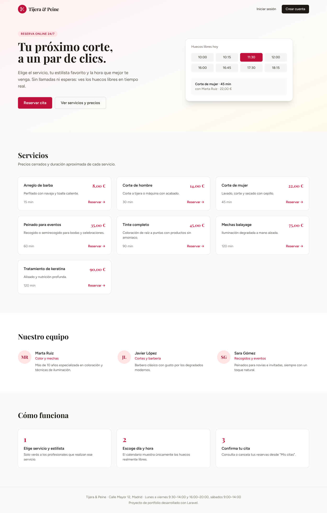
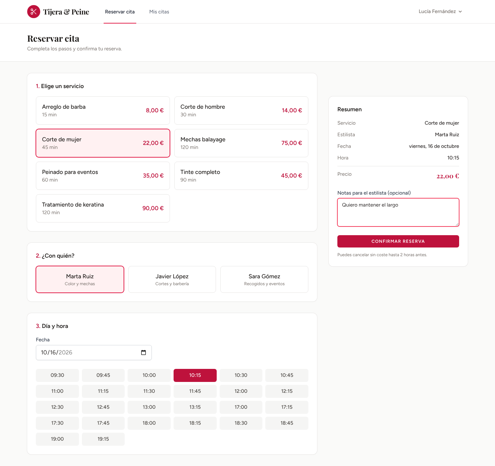
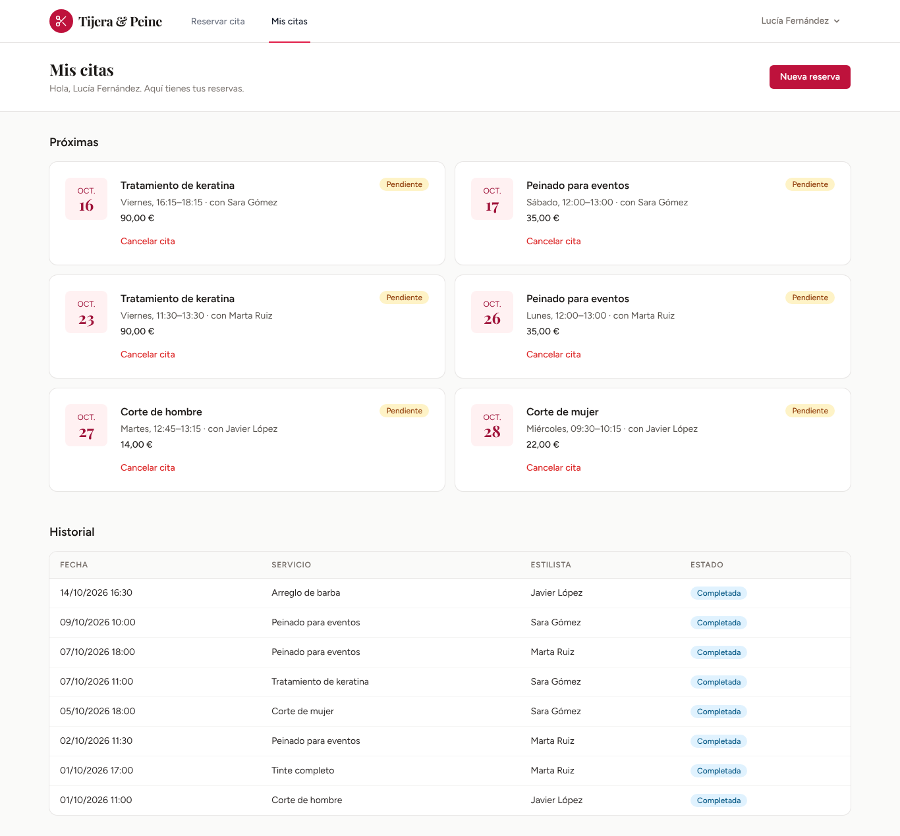
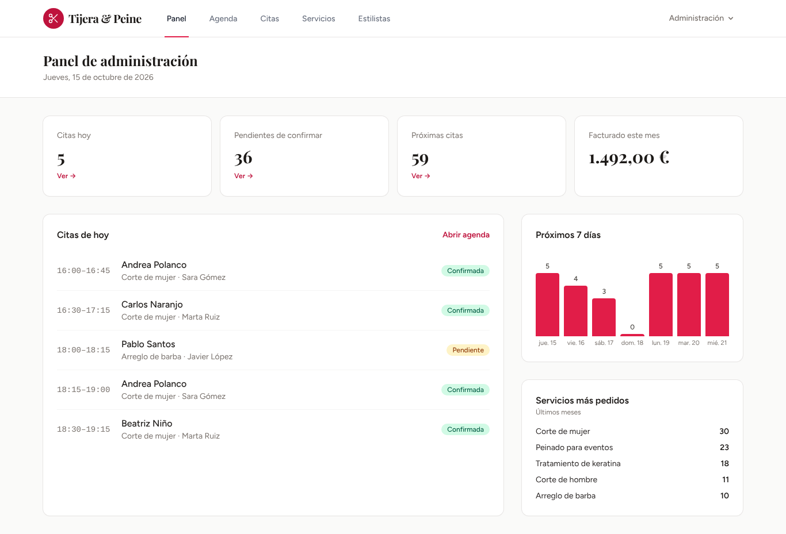
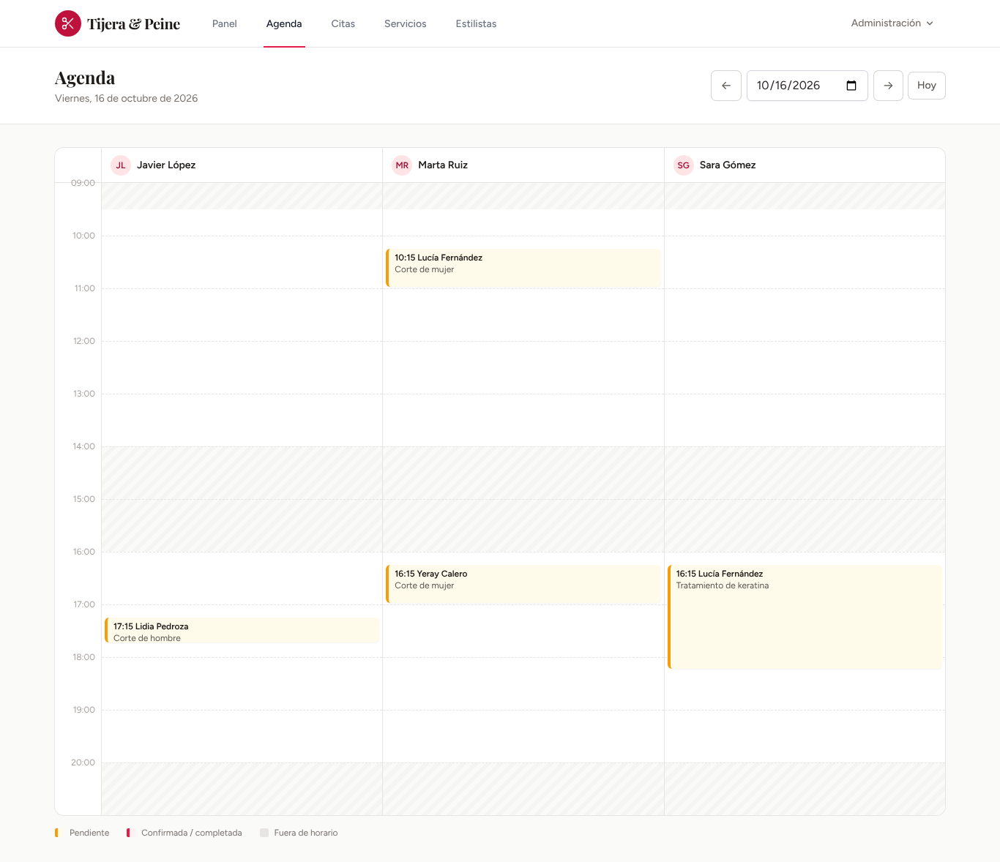
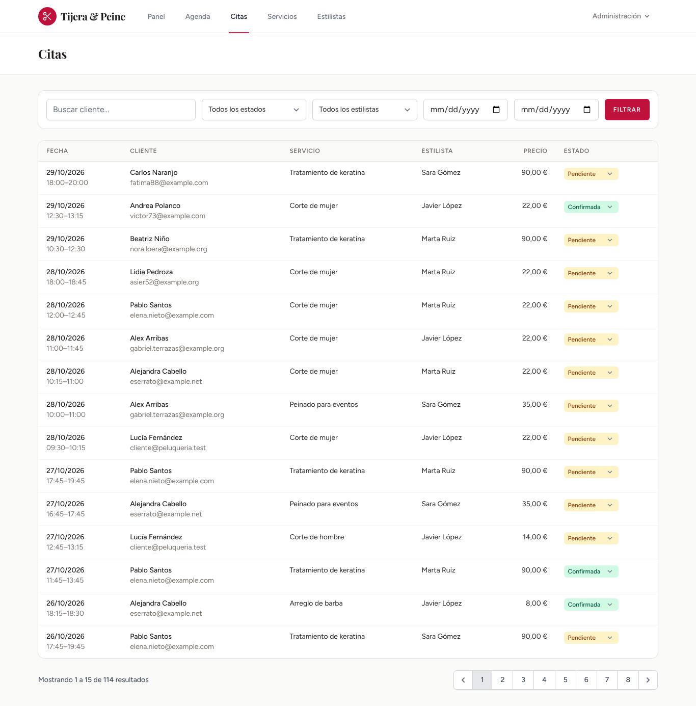
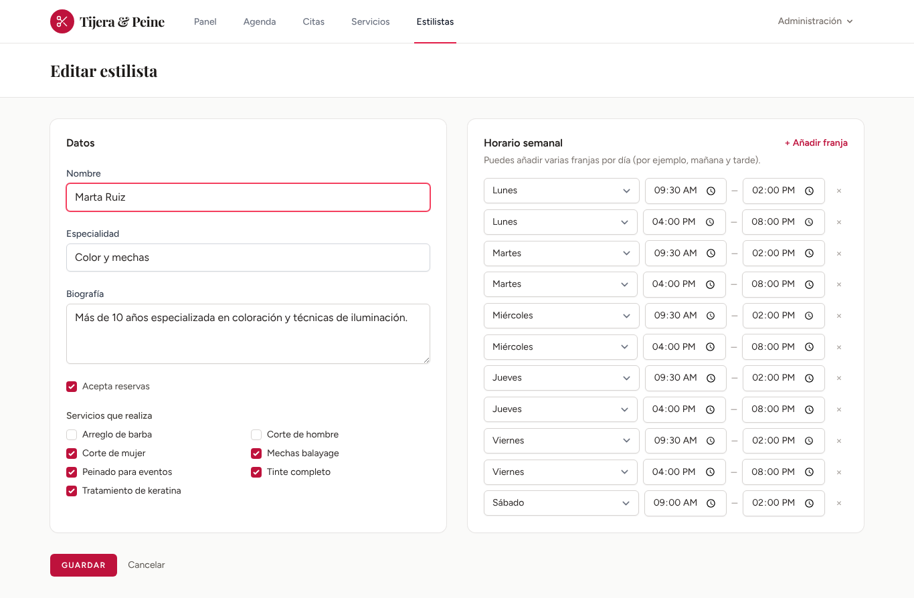

# Tijera & Peine · Reservas online para peluquería

Aplicación web full stack para gestionar las citas de una peluquería. Los clientes reservan en un par de clics viendo solo los huecos que de verdad están libres, y el personal gestiona la agenda, los servicios y los horarios desde un panel de administración.




## Funcionalidades

**Clientes**
- Registro e inicio de sesión (Laravel Breeze), con recuperación de contraseña.
- Reserva en tres pasos: servicio → estilista → día y hora. Solo aparecen los estilistas que hacen ese servicio y las horas libres de verdad, que se piden al servidor en tiempo real con Alpine.js.
- "Mis citas": próximas citas e historial, con cancelación hasta 2 horas antes.

**Administración**
- Panel con indicadores: citas de hoy, pendientes de confirmar, facturación del mes, gráfico de los próximos 7 días y servicios más pedidos.
- Agenda diaria por estilista, con las horas fuera de turno sombreadas.
- Listado de citas con filtros (cliente, estado, estilista, fechas), paginación y cambio de estado en línea.
- CRUD de servicios (duración y precio) y de estilistas (servicios que realizan y horario semanal con varias franjas por día).

## Capturas

| Reserva de cita | Mis citas |
| --- | --- |
|  |  |

| Panel de administración | Agenda diaria |
| --- | --- |
|  |  |

| Gestión de citas | Horario de un estilista |
| --- | --- |
|  |  |

## Decisiones técnicas

- **Cálculo de disponibilidad** (`app/Services/AvailabilityService.php`): genera huecos cada 15 minutos dentro de las franjas del estilista, comprueba que el servicio completo cabe antes del cierre de la franja y descarta los que se solapan con otra cita activa o ya han pasado. Las citas canceladas liberan el hueco.
- **Sin dobles reservas** (`app/Actions/BookAppointment.php`): al confirmar, la disponibilidad se vuelve a comprobar dentro de una transacción que bloquea la fila del estilista, así que dos clientes no pueden quedarse con la misma hora aunque reserven a la vez.
- **El precio se guarda en la cita**, de modo que subir la tarifa de un servicio no altera el histórico ni la facturación.
- **Roles** con un enum (`client` / `admin`), un middleware `admin` para el panel y una *policy* para que cada cliente solo pueda cancelar sus propias citas.
- **Enums de PHP** para el estado de la cita, con su etiqueta y su color, en lugar de cadenas sueltas por el código.
- **Form Requests** para validar servicios y estilistas, incluida la comprobación de que las franjas horarias de un mismo día no se solapan.
- Interfaz **en español** (traducciones de Breeze y de los mensajes de validación) y zona horaria `Europe/Madrid`.
- Tipografías servidas desde el propio proyecto (Fontsource), sin depender de CDNs externos.

## Modelo de datos

```
users ──< appointments >── stylists ──< working_hours
                │              │
                └──> services >┘  (service_stylist)
```

| Tabla | Campos principales |
| --- | --- |
| `users` | nombre, email, teléfono, rol |
| `services` | nombre, descripción, duración (min), precio, activo |
| `stylists` | nombre, especialidad, biografía, activo |
| `service_stylist` | qué servicios hace cada estilista |
| `working_hours` | estilista, día de la semana (1-7), hora inicio, hora fin |
| `appointments` | cliente, estilista, servicio, inicio, fin, estado, precio, notas |

## Instalación

Requisitos: PHP 8.3+, Composer y Node.js 20+.

```bash
git clone https://github.com/<tu-usuario>/peluqueria-reservas.git
cd peluqueria-reservas

composer install
npm install && npm run build

cp .env.example .env
php artisan key:generate

touch database/database.sqlite
php artisan migrate --seed

php artisan serve
```

Abre http://localhost:8000. El *seeder* crea servicios, tres estilistas con horario y citas de ejemplo de las dos semanas anteriores y siguientes.

| Rol | Email | Contraseña |
| --- | --- | --- |
| Administración | `admin@peluqueria.test` | `password` |
| Cliente | `cliente@peluqueria.test` | `password` |

### Usar MySQL

Las migraciones son compatibles con MySQL. Cambia estas variables en `.env` y vuelve a ejecutar `php artisan migrate --seed`:

```env
DB_CONNECTION=mysql
DB_HOST=127.0.0.1
DB_PORT=3306
DB_DATABASE=peluqueria
DB_USERNAME=root
DB_PASSWORD=
```

## Tests

```bash
php artisan test
```

69 tests con Pest que cubren el cálculo de huecos (solapes, horas pasadas, días sin turno, ventana de reservas), el proceso de reserva, las cancelaciones y sus permisos, y el panel de administración. GitHub Actions los ejecuta en cada *push* junto con la comprobación de estilo de Laravel Pint.

## Estructura

```
app/
├── Actions/BookAppointment.php        # Reserva con bloqueo para evitar solapes
├── Enums/                             # AppointmentStatus, Role
├── Http/Controllers/                  # Parte pública y de clientes
├── Http/Controllers/Admin/            # Panel, agenda, citas, servicios, estilistas
├── Http/Middleware/EnsureUserIsAdmin.php
├── Http/Requests/Admin/               # Validación de servicios y estilistas
├── Models/
├── Policies/AppointmentPolicy.php
└── Services/AvailabilityService.php   # Cálculo de huecos libres
resources/
├── js/booking.js                      # Componente Alpine del formulario de reserva
└── views/                             # Blade + Tailwind
tests/Feature/                         # Tests con Pest
```

## Posibles mejoras

- Emails de confirmación y recordatorio (Laravel Notifications y colas).
- Días festivos y vacaciones de cada estilista.
- Reserva sin registro, confirmada mediante un enlace por email.
- API REST con Laravel Sanctum para una app móvil.

## Licencia

MIT
